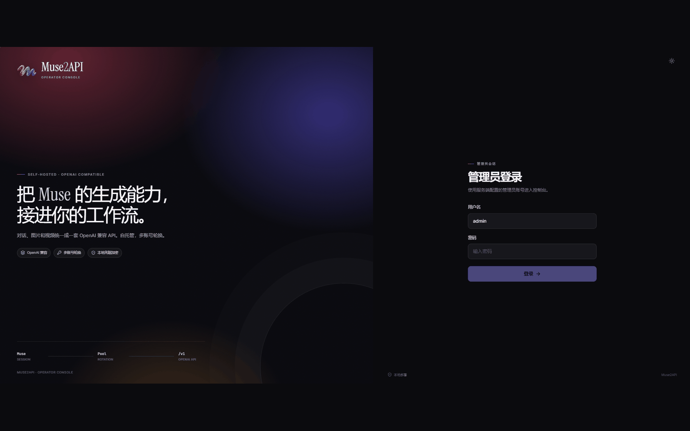

<p align="center">
  
</p>

<h1 align="center">Muse2API</h1>

<p align="center">
  <b>把 Muse 的对话、图片和视频能力，接成一套 OpenAI 兼容 API</b><br>
  自托管 · 多账号轮换 · Chromium/CDP · 带一个能干活的 Web 后台
</p>

<p align="center">
  
  
  
  
</p>

---

> [!IMPORTANT]
> 先把话说在前面：这是给**自己的 Muse 账号**用的自托管工具，不是 Muse 官方，也不是卖号、卖额度的项目。
>
> 你得有一个已经登录的 Muse 账号，Cookie 从自己的浏览器里导进来。项目不提供账号，也不碰登录、验证码和上游限流。上游风控、账号封禁这类风险，得你自己承担。

## 👋 这玩意儿是干什么的

一句话：它不是 Muse 官方 API，而是一个自己托管的小网关。后端用 Go，后台用 React，Chromium 在后台打开 Muse 页面干活；对外给你一套 `/v1` 接口，现成的 OpenAI 客户端、脚本或者自己的小工具改个 Base URL 就能接。

项目基于 [czg86389-hub/muse2api](https://github.com/czg86389-hub/muse2api) 的 Python 版本，用 Go + React 重写；`18610` 端口、Bearer Key、`/v1` 路径和 `./data` 数据目录这些使用习惯保持不变。

## 🧩 它现在能做什么

| 能力 | 现在的情况 |
|---|---|
| 💬 **对话** | `/v1/chat/completions`、`/v1/responses`，普通返回和 SSE 都支持。Responses 支持文本。 |
| 🎨 **图片** | 文生图、参考图编辑；同步接口和异步任务都能用。支持最多 4 张有序参考图。 |
| 🎬 **视频** | 一次生成一个片段，大约 10 秒、720p；任务里会记录实际时长和分辨率。支持 `images` 多图参考，第一张作为主要起始画面。 |
| 🔁 **账号池** | 多个账号轮着用，单账号限制并发，任务排队有上限；导入后自动检测会话、刷新额度。 |
| 🧷 **幂等** | 图片和视频任务认 `Idempotency-Key`，客户端重试不会重复提交上游。 |
| 🖥️ **Web 后台** | 账号、任务、媒体、API 调试台、模型能力、设置、日志都有，React + TypeScript 写的。 |
| 🔐 **登录与凭据** | 管理员用户名/密码进后台，和 API Key 分开。账号 Cookie 用 AES-256-GCM 加密存。 |
| 👁️ **API Key 保护** | 默认打码，想看完整的要再输一次管理员密码；30 秒后自动隐藏，能复制，查看和拒绝都会写审计日志。 |
| 🧩 **浏览器扩展** | Chrome / Edge 的 MV3 扩展，能把 Cookie Header 导成文本、JSON 或批量导入行。 |
| 📁 **媒体文件** | 落盘保存，默认要 Bearer 或管理员会话才能访问。 |
| 📦 **部署** | Docker Compose、源码 + systemd 都行，备份恢复脚本也带了。 |

## 🖥️ 后台长什么样



## 🚀 跑起来

两种路子，挑一种就行。不管哪种，都先准备一个已经登录 Muse 的账号。

### 先看环境

- **Docker**：Linux、Docker Engine 24+、Docker Compose v2。
- **源码**：Go 1.24+、Node 24+、Chromium/Chrome，最好有 `make`；没有就手动敲构建命令。Node 只在构建前端时用。
- 机器得能启动 Chromium。Docker 镜像里已经带了，源码跑的话自己装。

### 先把代码放 /opt

```bash
sudo mkdir -p /opt/muse2api
sudo chown "$USER":"$USER" /opt/muse2api
git clone <repo-url> /opt/muse2api
cd /opt/muse2api
```

下面默认项目就在 `/opt/muse2api`。

### 方式一：Docker Compose

```bash
cp .env.example .env

# 打开 .env，至少把这三个填了：
# MUSE2API_KEY              OpenAI 接口用的 Bearer Key
# MUSE2API_ADMIN_PASSWORD   后台管理员密码，至少 8 位
# MUSE2API_CREDENTIAL_KEY   base64 的 32 字节密钥
openssl rand -base64 32

# 建 ./data，并把目录交给容器用户 10001
sudo make init-data
# 没有 make 就：
# sudo sh deploy/init-data.sh

docker compose up -d --build
docker compose ps
```

默认只绑宿主机 `127.0.0.1:18610`，这是故意的，别一上来就把后台推到公网。

```bash
curl http://127.0.0.1:18610/healthz
```

后台在 `http://127.0.0.1:18610/admin`，账号是 `MUSE2API_ADMIN_USERNAME`（默认 `admin`），密码就是刚才那个 `MUSE2API_ADMIN_PASSWORD`。

宿主机用户不是 10001 的话，在 `.env` 里把 `MUSE2API_UID` 和 `MUSE2API_GID` 改成实际值，再跑一次 `sudo make init-data`。SELinux 的机器要是报权限错，给绑定挂载加个 `:Z`。

<details>
<summary><b>不想让密钥出现在 docker inspect 里？用文件</b></summary>

仓库里已经准备好 `deploy/docker-compose.secrets.yml`：

```bash
mkdir -p deploy/secrets
openssl rand -hex 32 > deploy/secrets/muse2api_key
printf '%s' 'a-long-random-admin-password' > deploy/secrets/muse2api_admin_password
openssl rand -base64 32 > deploy/secrets/muse2api_credential_key
chmod 700 deploy/secrets
chmod 0444 deploy/secrets/*

docker compose -f docker-compose.yml -f deploy/docker-compose.secrets.yml up -d --build
```

程序认 `MUSE2API_KEY_FILE`、`MUSE2API_ADMIN_PASSWORD_FILE`、`MUSE2API_CREDENTIAL_KEY_FILE` 和 `MUSE2API_PROXY_FILE`，文件优先于普通环境变量。用 secrets 之后，后面的 compose 命令也建议带上：

```bash
export COMPOSE_FILE=docker-compose.yml:deploy/docker-compose.secrets.yml
```

</details>

### 方式二：直接跑源码

不想碰 Docker，就在 `/opt/muse2api` 里就地构建：

```bash
cd /opt/muse2api
cp .env.example .env
# 编辑 .env；如果程序找不到浏览器，加一行 MUSE2API_CHROMIUM=/usr/bin/chromium
make build

mkdir -p data
chmod 700 data
MUSE2API_HOME=/opt/muse2api ./bin/muse2api
```

没有 `make` 的话，等价于：

```bash
cd web && npm ci && npm run build
cd ..
CGO_ENABLED=0 go build -trimpath -o bin/muse2api ./cmd/muse2api
```

前台跑着没问题，再交给 systemd。先建个专用用户（已经有了就跳过），把数据和 `.env` 给它：

```bash
sudo useradd --system --home-dir /opt/muse2api --shell /usr/sbin/nologin muse
sudo chmod 755 /opt/muse2api
sudo chown -R muse:muse /opt/muse2api/data
sudo chown muse:muse /opt/muse2api/.env
sudo chmod 600 /opt/muse2api/.env
sudo install -m 644 deploy/muse2api.service /etc/systemd/system/muse2api.service
sudo systemctl daemon-reload
sudo systemctl enable --now muse2api
sudo systemctl status muse2api
```

日志用 `journalctl -u muse2api -f` 看。

源码跑的时候别执行 Docker 那套 `sudo make init-data`，它会把 `data/` 改成 UID 10001；源码部署的数据目录归运行服务的用户。

默认会读 `/opt/muse2api/.env`。要是服务用户对项目目录没有执行权限，或者 Chromium 不在 `PATH` 里，就分别改目录权限、设 `MUSE2API_CHROMIUM`。不想新建 `muse` 用户也行，把 `deploy/muse2api.service` 里的 `User`/`Group` 换成现有用户，并让这个用户拥有 `data/` 和 `.env`。

### 放到公网

公网部署记得套 HTTPS 反向代理。Nginx 模板在 `deploy/nginx-tls.example.conf`，反代之后配置：

```dotenv
MUSE2API_TRUST_PROXY=1
MUSE2API_PUBLIC_BASE=https://api.example.com
```

代理要替换 `X-Forwarded-For`，不要把客户端传来的头直接往后追加。Nginx 模板里已经关了 `proxy_buffering`，不关的话 SSE 会憋成一次性输出。多参考图请求会比较大，模板里的 `client_max_body_size` 已经调到 `64m`，自己改过的话记得同步。

## 🔑 账号从哪来

进后台的“账号池”，点“添加账号”，把浏览器里登录 Muse 后的 Cookie Header 或 JSON 粘进去。必要的是两个：

- `hatch_sess`
- `hatch_vml`

`hatch_native_auth_device` 是可选设备标识，有就一起导入，没有也不会影响账号可用性。

保存后点“检测”，确认会话是活的。只导自己的号；Cookie 过期了就重新登录上游再更新。

导入成功后后台会自动检测会话、刷新额度，列表会轮询状态；批量导入按队列一个一个处理，不用再手动点“检测”和“刷新额度”。

不想手动抄 Cookie，可以用仓库自带的浏览器插件：Chrome / Edge 扩展页开开发者模式，加载 `browser-extension/` 目录，登录 muse.ai 后点扩展图标，就能复制 Cookie Header 或 JSON。也可以从 [GitHub Releases](https://github.com/vip0014/muse2api/releases) 下载最新 ZIP，解压后加载。详细说明在 [browser-extension/README.md](browser-extension/README.md)。

## 🔌 接口怎么调

先确认服务活着：

```bash
curl http://127.0.0.1:18610/v1/models \
  -H "Authorization: Bearer $MUSE2API_KEY"
```

Base URL 是 `http://127.0.0.1:18610/v1`，请求头带 `Authorization: Bearer $MUSE2API_KEY`。模型名用 `muse-spark`、`muse-image`、`muse-video`。

### 对话

```bash
curl http://127.0.0.1:18610/v1/chat/completions \
  -H "Authorization: Bearer $MUSE2API_KEY" \
  -H "Content-Type: application/json" \
  -d '{"model":"muse-spark","messages":[{"role":"user","content":"你好"}],"stream":false}'
```

### 图片

先建任务：

```bash
curl http://127.0.0.1:18610/v1/images/tasks \
  -H "Authorization: Bearer $MUSE2API_KEY" \
  -H "Content-Type: application/json" \
  -H "Idempotency-Key: my-image-1" \
  -d '{"prompt":"海边的灯塔","response_format":"url"}'
```

然后 `GET /v1/images/tasks/{id}` 查。想同步等结果就用 `POST /v1/images/generations`，参考图编辑用 `POST /v1/images/edits`。

多图参考用有序的 `images` 数组，最多 4 张；`images` 不能和 `image` / `reference_image` 混用：

```bash
curl http://127.0.0.1:18610/v1/images/generations \
  -H "Authorization: Bearer $MUSE2API_KEY" \
  -H "Content-Type: application/json" \
  -d '{
    "model":"muse-image",
    "prompt":"结合第一张图的主体与第二张图的配色生成海报",
    "images":[
      {"url":"https://example.com/subject.png"},
      {"url":"https://example.com/style.png"}
    ],
    "response_format":"url"
  }'
```

`/v1/images/edits` 的 multipart 请求可以重复提交同名的 `image` 字段。

### 视频

`POST /v1/videos` 建任务，`GET /v1/videos/{id}` 查。`/v1/videos/generations` 是兼容路径，行为一样。

多图参考视频用同一个 `images` 数组，第一张作为主要起始画面，其余作为主体、场景和风格参考。参考只接受图片：

```bash
curl http://127.0.0.1:18610/v1/videos \
  -H "Authorization: Bearer $MUSE2API_KEY" \
  -H "Content-Type: application/json" \
  -d '{
    "prompt":"让第一张图的主体在第二张图的场景与配色中运动",
    "images":[
      {"url":"https://example.com/start.png"},
      {"url":"https://example.com/style.png"}
    ],
    "duration":6,
    "size":"16:9"
  }'
```

视频只能生成单片段。官网默认大约 10 秒、720p，带声音；`duration` 不控制上游，只作为请求元数据留着：

- 留空或 1～10：都按官网默认，约 10 秒
- 大于 10：直接 400
- `aspect_ratio` / `resolution` 只能写进提示词，不保证精确；想要 16:9 或 9:16，直接在 prompt 里写清楚

需要更长的视频时，就在画布或自己的客户端里分段生成、自己拼接。

任务结果里的 `result.duration_ms`、`result.width`、`result.height` 是从 MP4 元数据里解析的；解析失败就不写这几个字段，不影响视频文件本身。

媒体 URL 默认也要认证。浏览器里已经登录后台就能直接预览；外部客户端下载时带上 Bearer。只有显式设置 `MUSE2API_PUBLIC_MEDIA=1` 才会恢复匿名访问。

### 路径清单

- `GET /v1/models`
- `POST /v1/chat/completions`
- `POST /v1/responses`
- `POST /v1/images/generations`
- `POST /v1/images/edits`
- `POST /v1/images/tasks`
- `GET /v1/images/tasks/{id}`
- `POST /v1/videos` 或 `POST /v1/videos/generations`
- `GET /v1/videos/{id}` 或 `GET /v1/videos/generations/{id}`
- `GET /v1/media/{name}`

## ⚙️ 配置

必填的就三个：

| 变量 | 说明 |
|---|---|
| `MUSE2API_KEY` | `/v1/*` 的 Bearer Key。启动后也能在后台轮换，轮换结果写到 `data/api_key.secure` |
| `MUSE2API_ADMIN_PASSWORD` | 后台管理员密码，至少 8 位 |
| `MUSE2API_CREDENTIAL_KEY` | 32 字节随机值的 base64，用来加密账号 Cookie。这个丢了，旧账号就解不开了 |

后台系统设置里的 API Key 默认是打码的。点“显示”要再输一次管理员密码，验证过了才返回完整 Key；查看和拒绝都会写审计日志，弹窗 30 秒后自动隐藏，旁边有复制按钮。

常用的可选项：

| 变量 | 默认 | 说明 |
|---|---|---|
| `MUSE2API_ADMIN_USERNAME` | `admin` | 后台管理员用户名 |
| `MUSE2API_BIND` | `127.0.0.1` | Compose 绑定地址 |
| `MUSE2API_UID` / `MUSE2API_GID` | `10001` | 容器运行用户，得和 `data/` 所有者一致 |
| `MUSE2API_MAX_UPLOAD_BYTES` | `41943040` | 请求体上限；24 MiB 原图转 base64 后需要更宽的上限，改大时记得同步改 Nginx 的 `client_max_body_size` |
| `MUSE2API_REF_IMAGE_LOCAL_FILES` | `0` | 设为 `1` 才允许参考图读取服务器本地文件路径 |
| `MUSE2API_REF_IMAGE_PRIVATE_FETCH` | `0` | 设为 `1` 才允许参考图下载私网/本机 URL；默认只允许公网并逐跳检查重定向 |
| `MUSE2API_BROWSER` | `1` | 设成 `0` 就不启动 Chromium，对话、生成和额度都用不了 |
| `MUSE2API_LOG_LEVEL` | `info` | 日志级别 |

其余的超时、并发、队列、目录这些，都在 `.env.example` 里。注意 `.env.example` 里的占位值会被程序拒绝，别直接拿来启动。

### 参考图安全

默认情况下，参考图只接受这几种来源：

- `data:` URL
- 裸 base64
- 公网 `http(s)` URL

服务器本地文件路径、私网/本机地址默认都拒绝。确实需要的话，再显式打开：

```dotenv
MUSE2API_REF_IMAGE_LOCAL_FILES=1
MUSE2API_REF_IMAGE_PRIVATE_FETCH=1
```

这两个开关只建议在可信的单用户部署里打开。尤其是私网抓取，等于允许 API 调用方通过参考图 URL 访问你的内网，不要在不信任调用方的环境里开。

参考图超限、MIME 不对、下载失败或地址被策略拒绝，都会在创建任务前返回 400。

## 🕳️ 几个坑，提前说

- 它不是纯 HTTP 协议实现。对话、生图、视频、额度都靠 Chromium 打开 Muse 页面，页面改版后选择器可能要跟着修。
- `gpt-4o`、`claude-sonnet-4` 会落到 `muse-spark`，`dall-e-3` 落到 `muse-image`，`sora` 落到 `muse-video`。这些只是兼容别名，不代表对应的官方模型能力。
- 浏览器页面操作目前是全局串行的。本地任务并发不等于上游并行生成。
- 视频只能单片段，大约 10 秒、720p；`duration` 不控制上游；比例只能靠提示词；长视频自己分段。
- 参考图默认只接受 data URL、base64 和公网 http(s) URL；本地文件和私网地址默认拒绝，需要时用上面两个开关显式放开。参考图超限、MIME 不对或下载失败会在创建任务前直接返回 400。
- 账号必填 Cookie 只有 `hatch_sess` 和 `hatch_vml`；`hatch_native_auth_device` 是可选项。
- 服务重启时，遗留的排队/运行中任务会标成 `unknown`，不会自动重放，避免重复扣费。管理员会话保存在内存，重启后要重新登录。
- 后台的备份恢复要重启服务，当前进程不会热加载恢复后的数据。
- 兼容旧版 `accounts.json/tasks.json`；首次启动会把旧账号加密迁移。升级前先备份 `data/` 和加密 Key。
- 别把 CDP 端口 `19210` 发布到宿主机。`data/chromium` 里的 profile 和生成的媒体，都按敏感数据对待。

## 🧯 遇到问题先看这几条

**登录后台后看不到账号，或者检测返回 401？**

Cookie 过期了。重新在自己的浏览器里登录 Muse，再更新账号。

**接口返回 503，说能力不可用？**

先确认 `MUSE2API_BROWSER=1`，再看容器日志里的 Chromium / CDP 错误。`MUSE2API_BROWSER=0` 是主动降级，不是 bug。

**Nginx 后面的 SSE 不实时？**

确认 `proxy_buffering off`，并保留后端返回的 `X-Accel-Buffering: no`。

**参考图接口直接返回 400？**

先看错误是不是“不是图片”“超过限制”“地址被拒绝”。默认不允许本地文件和私网 URL；需要的话检查 `MUSE2API_REF_IMAGE_*` 两个开关。多图请求还要确认 `.env` 里的 `MUSE2API_MAX_UPLOAD_BYTES` 够大。

**容器报 `permission denied`？**

`data/` 的所有者要和容器用户一致。跑 `sudo make init-data`，或者设 `MUSE2API_UID/GID`。

**重启后任务变成 `unknown`？**

服务不知道上游到底完成没有，所以不会自动重试。按任务 ID 人工核对，避免重复扣费。

## 💾 备份、恢复和升级

### 备份

Docker：

```bash
make backup
```

源码 + systemd：

```bash
sudo env MUSE2API_SYSTEMD_UNIT=muse2api make backup
```

脚本会短暂停服务，打包 `data/`，默认跳过能重建的 `data/chromium` 和 `data/downloads`。归档默认放在项目下的 `backups/`。

### 恢复

Docker：

```bash
docker compose stop muse2api
mv data "data.before-restore-$(date -u +%Y%m%dT%H%M%SZ)"
tar -xzf backups/muse2api-data-YYYYMMDDTHHMMSSZ.tar.gz -C .
sudo chown -R 10001:10001 data   # 改过 MUSE2API_UID/GID 就用实际值
docker compose up -d
```

源码 + systemd：

```bash
sudo systemctl stop muse2api
cd /opt/muse2api
sudo mv data "data.before-restore-$(date -u +%Y%m%dT%H%M%SZ)"
sudo tar -xzf backups/muse2api-data-YYYYMMDDTHHMMSSZ.tar.gz -C .
sudo chown -R muse:muse data
sudo systemctl start muse2api
```

别直接盖掉现有的 `data`。归档里有账号密文和媒体，按敏感文件保管。

### 升级

Docker：

```bash
make backup
docker compose build --pull
docker compose up -d
```

源码 + systemd：

```bash
sudo env MUSE2API_SYSTEMD_UNIT=muse2api make backup
git pull
make build
sudo systemctl restart muse2api
```

## 🛠️ 本地开发

要 Go 1.24+、Node 24+，机器上还得有 Chromium/Chrome。

```bash
make test
make build
cp .env.example .env
go run ./cmd/muse2api
```

前端单独调的话：

```bash
cd web && npm run dev -- --port 7100
```

Vite 会代理到 `127.0.0.1:18610`。

## 🧭 目录结构

```text
cmd/muse2api/            程序入口
internal/server/         HTTP 服务、管理 API、任务编排
internal/muse/browser/   Chromium/CDP 驱动、页面操作、媒体提取
internal/muse/protocol/  驱动接口与原生 HTTP 兜底
internal/refimage/       参考图解析、大小/MIME 校验、SSRF 防护
internal/storage/        AES-GCM 账号存储、任务与事件持久化
internal/scheduler/      账号池与并发调度
web/                     React + TypeScript 管理后台
browser-extension/       Chrome / Edge MV3 导号扩展
deploy/                  Docker secrets、systemd、Nginx 模板
docs/screenshots/        README 截图
```

## 🛡️ 安全与合规

- 只导自己的账号。不要批量注册、转卖额度，也别拿它绕上游限制。
- 管理员密码、API Key、`MUSE2API_CREDENTIAL_KEY` 分开备份。加密 Key 丢了，旧账号 Cookie 就回不来了。
- 生产环境上 HTTPS。CDP 端口 `19210` 只在容器内监听，别映射到宿主机。
- `data/` 里有账号密文、媒体和浏览器 profile，别提交到 Git，也别扔进公开备份。
- 参考图的本地文件和私网开关默认关闭；只有在确认调用方可信时才打开。

## License

[MIT](LICENSE)
